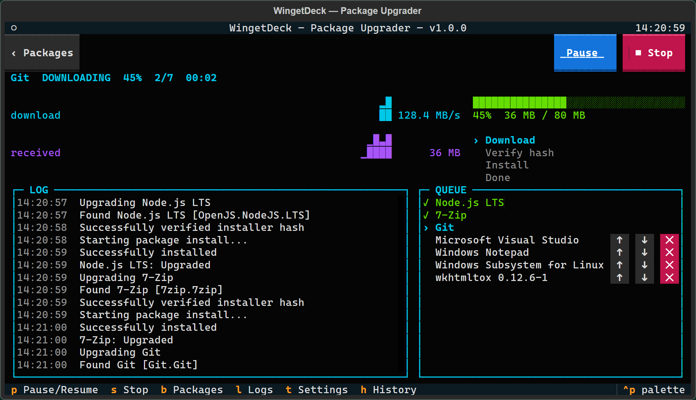
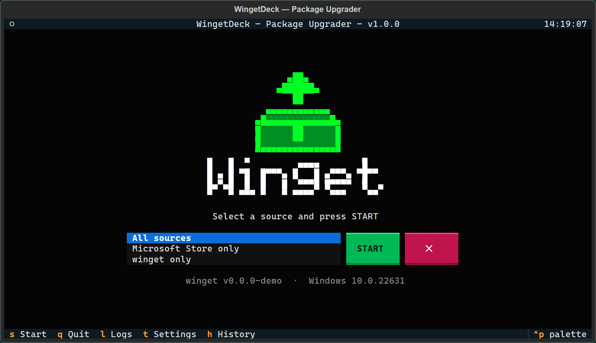
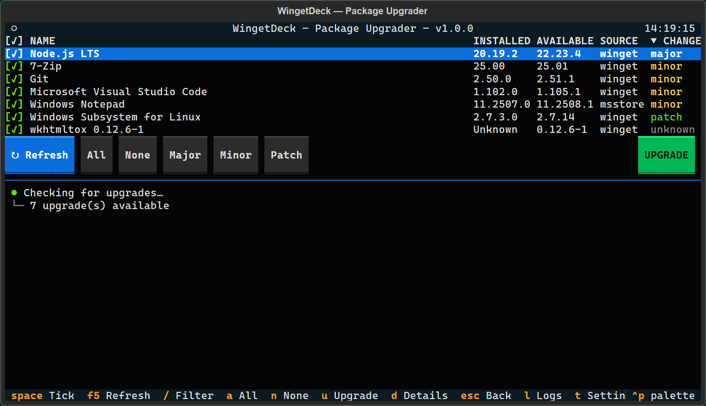
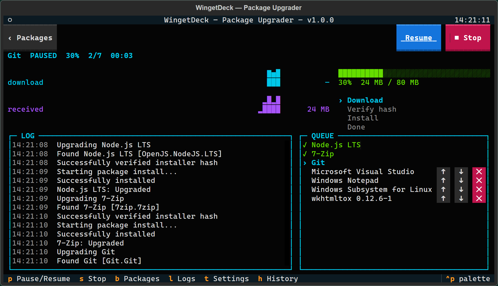
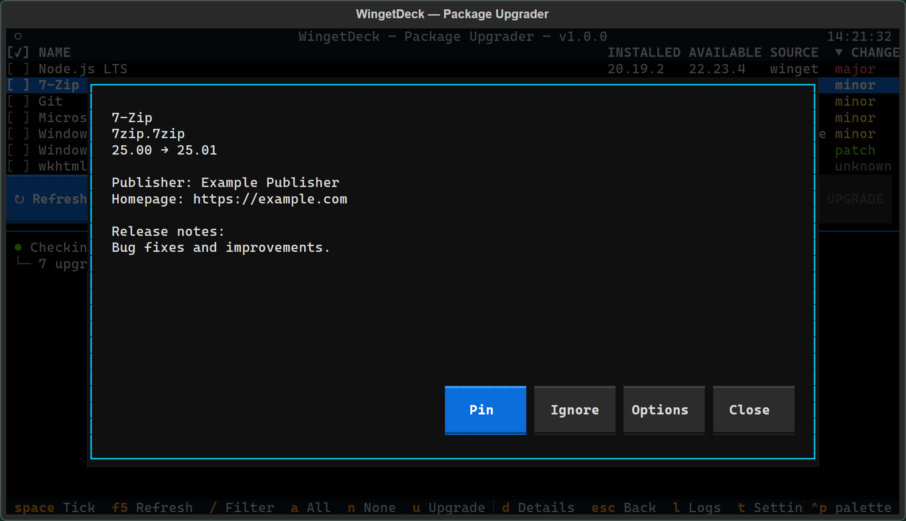
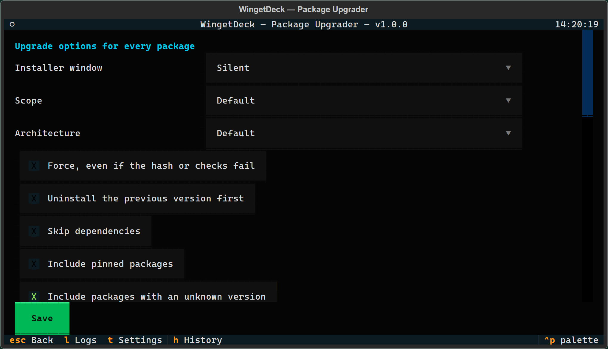
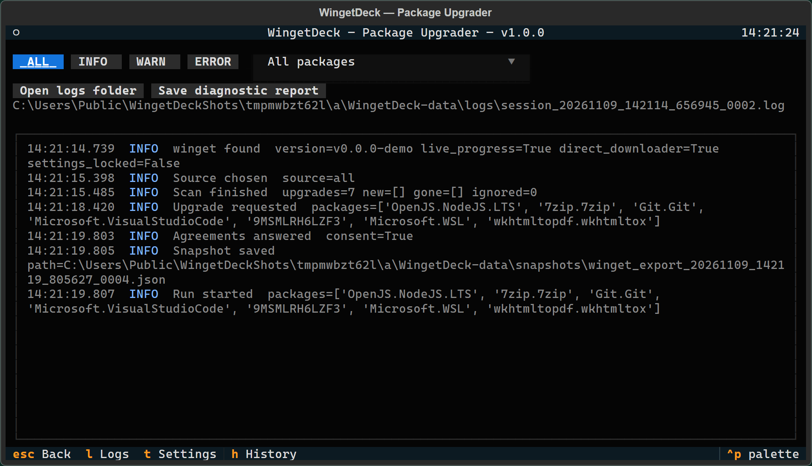

<p align="center">
  
</p>

<h1 align="center">WingetDeck</h1>

<p align="center">
  Upgrade your Windows apps through winget, in a window you can click.<br>
  Tick what you want, press <b>UPGRADE</b>, then pause, stop or resume while it runs.
</p>

<p align="center">
  <a href="https://github.com/arbarak/WingetDeck/releases/latest"><b>Download</b></a> &nbsp;|&nbsp;
  <a href="https://arbarak.github.io/WingetDeck/"><b>Details page</b></a> &nbsp;|&nbsp;
  <a href="https://github.dev/arbarak/WingetDeck">Read the code in your browser</a> &nbsp;|&nbsp;
  <a href="docs/TESTED.md">What has been tested</a>
</p>



> [!WARNING]
> **This is the first release.** It has read real upgrade lists from real winget, but the finished app has not yet
> carried out a real upgrade. Try `WingetDeck-x64.exe --demo` first, which installs nothing.
> [docs/TESTED.md](docs/TESTED.md) lists exactly what was and was not checked.

## What it does

- **Shows every available upgrade** in a table, with the size of each change: major, minor or patch.
- **Upgrades only what you tick**, one package at a time, with live speed, percent and log.
- **Tells the truth about Pause and Stop.** The buttons change with what winget is doing at that moment.
- **Lets you change your mind mid-run:** reorder the queue, or take a package out of it.
- **Picks up where it stopped.** If the app closes, crashes or the PC restarts, it offers to continue the queue.
- **Keeps a record:** a list of your installed versions before each run, a history, and full logs.
- **Fits your window,** from a small terminal to full screen, and works with the mouse or the keyboard.
- **Is one portable exe,** with no installer, no admin rights and no Python needed.

## Screenshots

These all come from demo mode, so the packages, versions and speeds are pretend.

<table>
  <tr>
    <td width="50%"></td>
    <td width="50%"></td>
  </tr>
  <tr>
    <td><b>Start.</b> Choose a source and press START.</td>
    <td><b>Packages.</b> Tick by clicking, or by size of change with Major, Minor and Patch.</td>
  </tr>
  <tr>
    <td></td>
    <td></td>
  </tr>
  <tr>
    <td><b>Paused.</b> Pause becomes Resume, and the queue stays as it was.</td>
    <td><b>Details.</b> See a package's versions and notes, then pin it, ignore it or set options.</td>
  </tr>
  <tr>
    <td></td>
    <td></td>
  </tr>
  <tr>
    <td><b>Settings.</b> Options for every package, and how the app behaves.</td>
    <td><b>Logs.</b> Filter by level or package, and save a report for bug reports.</td>
  </tr>
</table>

## Run it

Copy `WingetDeck-x64.exe` anywhere and double-click it. You need Windows 10 version 1809 or newer, and winget 1.4 or
newer. If winget is missing or too old, the app says how to get it.

```
WingetDeck-x64.exe            the real thing
WingetDeck-x64.exe --demo     try everything with a pretend winget; nothing is installed
WingetDeck-x64.exe --ascii    plain characters, for consoles that cannot draw symbols
WingetDeck-x64.exe --debug    also log every line winget prints
WingetDeck-x64.exe --version  print the version
```

**Which exe:** `WingetDeck-x64.exe` for nearly every PC. `WingetDeck-x86.exe` is for 32-bit Windows and has no live
percent or speed, only an animation and the elapsed time. There is no ARM64 exe in this release.

**The SmartScreen warning:** the exe is not signed, so Windows may say it is from an unknown publisher. Choose
**More info**, then **Run anyway**, if you trust where the file came from. Each release lists SHA-256 checksums, and
[SECURITY.md](SECURITY.md) shows how to check them.

## Using it

1. Choose a source and press **START**.
2. Tick packages by clicking, or with the keys in the footer. **Refresh** looks for anything new.
3. Press **UPGRADE**. Each installer may show its own Windows permission prompt, unless you restart as administrator
   from Settings.

### Pause and Stop

What Pause can do depends on the stage, and the button always says what it will really do:

| Stage | Pause | Stop |
|---|---|---|
| Downloading, direct downloader on | Pauses right now | Stop after this one, or Stop now |
| Downloading, direct downloader off | Pause after this package | Stop after this one, or Stop now (the download may finish in the background) |
| Installing | Pause after this install. An installer is never frozen. | Stop after this one, or Force stop (asks twice) |

**The direct downloader trade-off.** By default, a Windows service does winget's downloading, and that service keeps
going when winget is paused or stopped. Setting winget's `network.downloader` to `wininet` makes Pause really stop
the transfer, but there is no per-run option: it applies to all winget use on the PC. So WingetDeck never changes it
without asking. The first time you press Pause during a download it explains this and offers to turn it on, backs up
your settings file first, and Settings can undo it. If policy locks winget's settings, the offer is not made.

A partial download can be left in winget's temp folder after Stop.

**Quitting during a run** asks first, and offers to quit once the current package is done. Winget does not outlive the
app, so quitting or closing the window during an install ends winget: an installer that has started may carry on by
itself, but the package could be left half-installed. Closing the window gives no chance to ask, so prefer **Quit**.

If the app is closed, crashes or the PC restarts mid-run, it offers to continue the queue next time. Ending it from
Task Manager while a download is frozen cannot unfreeze winget, so end the leftover `winget` process too.

## Where your data lives

Settings, the saved queue, snapshots and logs go in `WingetDeck-data` beside the exe. If that folder cannot be written
to, or the app is running as administrator, they go in `%LOCALAPPDATA%\WingetDeck` instead, and the start screen shows
which is in use. `--demo` keeps its data in a separate `demo` subfolder. Nothing is ever deleted automatically.

The app has no network code of its own: all downloads are winget's, and it sends no data anywhere.

## When something goes wrong

Press `l` for the Logs screen, which also has **Open logs folder** and **Save diagnostic report**: a dated zip for bug
reports, with your user name and the secrets it recognises removed. A custom installer argument containing spaces can
slip through, so read the report before you share it. Every run writes a timeline, and each package keeps winget's
full output. If the app itself crashes, it restores the terminal and shows the path of a crash log.

To report a security problem, see [SECURITY.md](SECURITY.md).

## Building

```powershell
py -3.12 -m venv .venv
.venv\Scripts\python -m pip install -e .[dev]
.venv\Scripts\python -m pytest
scripts\build.ps1
```

The exe goes in `dist\<date>\`, and earlier builds are kept. For x86, make a 32-bit `.venv-x86` and install only
`textual` and `pyinstaller` in it, since `pywinpty` has no x86 version:

```powershell
uv python install cpython-3.12-windows-x86-none
uv venv --python cpython-3.12-windows-x86-none .venv-x86
uv pip install --python .venv-x86\Scripts\python.exe "textual>=8.2,<9" "pyinstaller>=6.22,<7"
scripts\build.ps1 -Arch x86
```

Checks for a built exe, none of which open a window or upgrade anything:

```powershell
.venv\Scripts\python scripts\pty_check.py --exe path\to.exe           # resizing, with the real terminal driver
.venv\Scripts\python scripts\portable_check.py path\to.exe WORK_DIR   # odd paths, no Python, read-only folder
.venv\Scripts\python scripts\real_scan_check.py path\to.exe           # reads real winget; never presses Upgrade
```

The design is written up in [docs/design.md](docs/design.md).

## Credits

The look takes its inspiration from [wifit3](https://github.com/derv82/wifit3). The code and art here are original.
Built with [Python](https://www.python.org/), [Textual](https://github.com/Textualize/textual),
[pywinpty](https://github.com/andfoy/pywinpty) and [PyInstaller](https://pyinstaller.org/).
